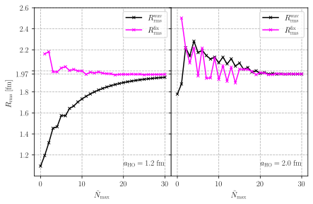

# Deuteron Calculations

Code for my Bachelor's thesis on **ab initio calculations of the deuteron in a harmonic-oscillator basis** and on **correcting the wrong asymptotic behaviour of the truncated wave function** to get converged long-range observables.

## Background

The deuteron ground state ($J^\pi = 1^+$, $T = 0$) is a coupled $^3S_1$–$^3D_1$ state. Here it is obtained by diagonalising the Hamiltonian

$$H = T_\text{rel} + V_\text{NN}$$

with a chiral two-nucleon interaction in a harmonic-oscillator (HO) basis truncated at $N_\text{max}$, for several oscillator lengths $a_\text{HO}$.

The ground-state energy converges quickly in this basis. Observables that depend on the long-range part of the wave function, such as the **rms radius** $r_\text{rms}$ and the **electric quadrupole moment** $Q$, converge slowly. The reason is that every HO basis function falls off like a Gaussian, $e^{-r^2}$, while the real bound-state wave function has an exponential tail, $e^{-\kappa r}$.

## Method

1. **Build the Hamiltonian matrix.** Read the HO matrix elements and select the $S=1,\ J=1,\ T=0$ channel. Assemble the coupled $L = 0, 2$ blocks up to $N_\text{max}$ and diagonalise.
2. **Reconstruct the wave function.** Rebuild the S- and D-wave radial functions $u(r)$ and $w(r)$ in position space from the HO radial functions (generalised Laguerre polynomials).
3. **Asymptotic continuation.** Beyond a matching radius, replace the Gaussian tail with the correct asymptotic form, the modified spherical Hankel functions:
   - $L=0$: $\; \propto \dfrac{e^{-\kappa r}}{\kappa r}$
   - $L=2$: $\; \propto \dfrac{e^{-\kappa r}}{\kappa r}\left(1 + \dfrac{3}{\kappa r} + \dfrac{3}{(\kappa r)^2}\right)$

   The matching region is found automatically by comparing the wave functions at $N_\text{max}$ and $N_\text{max}-1$: where they still agree, the wave function is considered converged. Two variants are compared:
   - **fixed κ**, taken from the deuteron binding energy
   - **fitted κ**, a free fit parameter

   An earlier variant with a purely exponential continuation is also included.
4. **Observables.** Compute $r_\text{rms}$ and $Q$ from the continued wave functions. Compare them with direct HO expectation values across $N_\text{max}$ and $a_\text{HO}$, with uncertainties from averaging over neighbouring $a_\text{HO}$.
5. **Comparison with ANN extrapolations.** Compare the continued results with radius predictions from artificial-neural-network extrapolations.

## Repository structure

```
src/
├── make/                       # Hamiltonian matrix + position-space wave function
├── h_eigval/                   # ground-state energy vs. Nmax / aHO
├── position_space_wavefunc/    # wave function plots, tail slopes
├── rrms/
│   ├── rrms_expval/            # direct HO expectation values
│   ├── rrms_continuation_exp/    # exponential continuation
│   └── rrms_continuation_hankel/ # Hankel-function continuation (fixed / fitted κ)
├── q_moment/                   # quadrupole moment Q
├── connection_visualization.py # illustration of the matching procedure
├── fitpoint_find_visualization.py
├── rrms_nmax_Nmax_comparison.py
└── plotstyle/, stylesheet.mplstyle  # LaTeX-sized matplotlib styling
matrix_elements/     # HO matrix elements of the interaction and T_rel (input)
calculated_values/   # resulting r_rms and Q values
final_plots/         # figures used in the thesis
```

## Selected results



*rms radius of the deuteron vs. Ñmax for a_HO = 1.2 fm and 2.0 fm: directly from the HO wave function (black) and with the Hankel-function continuation at fixed κ (magenta). The continued radius settles near 1.97 fm at much smaller Ñmax, especially for a_HO = 1.2 fm.*

| | |
|---|---|
| Wave function continuation | [`final_plots/wave_functions/`](final_plots/wave_functions) |
| rms radius vs. $N_\text{max}$ | [`final_plots/rrms/`](final_plots/rrms) |
| Quadrupole moment | [`final_plots/q/`](final_plots/q) |
| Comparison with ANN predictions | [`final_plots/ANN_comparison/`](final_plots/ANN_comparison) |
| Matching method | [`final_plots/fitting_method/`](final_plots/fitting_method) |

## Running

Python 3.12 with `numpy`, `scipy`, `matplotlib`, `lmfit`, `uncertainties` and `joblib`:

```bash
pip install numpy scipy matplotlib lmfit uncertainties joblib
python src/rrms/rrms_continuation_hankel/rrms_wavefunc_continuation_fixed_kappa.py
```

Run the scripts from the repository root, because the paths to `matrix_elements/` and the stylesheet are relative to it.
